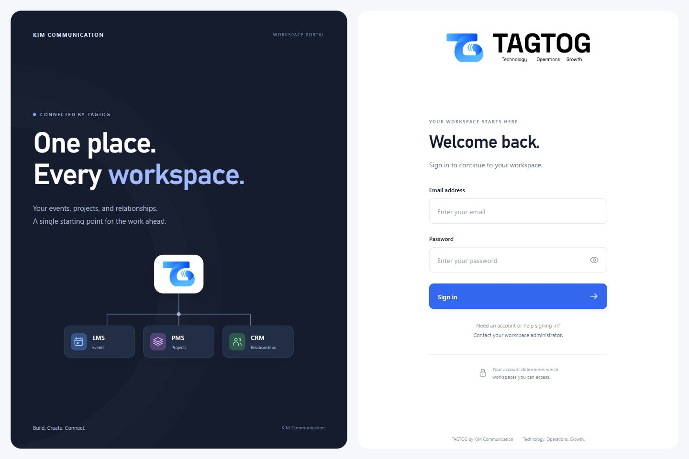

# TAGTOG Dashboard

Portal workspace KIM Communication untuk mengakses EMS, PMS, dan CRM melalui satu pintu masuk. Versi ini mencakup dashboard, halaman login dengan logo resmi TAGTOG, server portal Node.js, dan prototipe pengaturan akses melalui EMS-IAM.



## Status

- Halaman awal mengharuskan login. Login dan logout sudah dicoba dengan EMS-IAM pada lingkungan lokal terisolasi.
- Portal menampilkan aplikasi berdasarkan hak akses dari IAM dan menyediakan halaman admin untuk user, role, dan pemetaan akun PMS.
- Integrasi SSO PMS masih berupa prototipe lintas repositori. Pengujian menyeluruh portal → PMS belum selesai; source IAM dan PMS tidak disertakan di repo ini.
- Integrasi EMS dan CRM belum diaktifkan.
- Schema akun personal/perusahaan, paket, dan masa aktif masih **rancangan**, belum diimplementasikan. Lihat [rancangan schema dan ERD](docs/SCHEMA-PUSAT-DAN-ERD.md).
- Kode ini untuk pengembangan lokal. Belum ada deployment produksi.

## Menjalankan portal

Prasyarat: Node.js 20 atau lebih baru. Server portal tidak memakai dependensi npm tambahan.

```bash
git clone https://github.com/josephthewarrior1/Tagtog-dashboard.git
cd Tagtog-dashboard
npm start
```

Buka **http://127.0.0.1:4180/**. Halaman login dapat dilihat saat server portal berjalan, tetapi proses masuk memerlukan EMS-IAM yang tersedia. Secara default, IAM berada di `http://127.0.0.1:8181`, PMS API di `http://127.0.0.1:8182`, dan PMS web di `http://127.0.0.1:8184`.

Alamat layanan dapat diatur melalui environment variable `TAGTOG_ORIGIN`, `TAGTOG_IAM_URL`, `TAGTOG_PMS_API_URL`, dan `TAGTOG_PMS_URL`. Server membaca environment proses dan konfigurasi lokal; file `.env` tidak dimuat otomatis. Jangan membuka `index.html` langsung atau memakai server statis untuk alur autentikasi.

Untuk stack integrasi lengkap di mesin pengembangan yang sudah memiliki repo EMS-IAM dan PMS beserta penyesuaiannya, ikuti [panduan integrasi lokal](INTEGRATION-LOCAL.md). `start-local.cmd` menjalankan penyiapan stack tersebut dan membutuhkan Docker Desktop, Java 21, repo terkait, serta executable JAR yang sudah dibangun. Perintah itu bukan pemasang repo IAM/PMS.

## Pengujian

```bash
npm test
```

Pengujian portal memakai server HTTP dan layanan IAM tiruan yang terisolasi. Tidak memerlukan database atau kredensial produksi. Script uji integrasi manual berada terpisah dari suite ini; keberadaannya bukan bukti bahwa seluruh alur PMS sudah lolos pengujian.

## Struktur

| File/folder | Isi |
| --- | --- |
| `login.html`, `auth.css`, `login.js` | Tampilan login desktop/mobile dan pengiriman kredensial ke server portal |
| `index.html`, `styles.css`, `app.js` | Dashboard aplikasi dan navigasi |
| `admin.html`, `admin.css`, `admin.js` | Antarmuka user, role, dan tautan akun PMS |
| `server.cjs` | Server portal, sesi, dan penghubung API IAM/PMS |
| `local-stack.cjs`, `start-local.cmd` | Helper lingkungan integrasi lokal |
| `assets/` | Logo resmi dan aset lokal |
| `previews/` | Screenshot login desktop/mobile terbaru |
| `design/` | Sumber FigCraft dan ekspor desain pendamping versi sebelumnya |
| `docs/` | Audit integrasi, rancangan schema pusat, dan ERD Mermaid |
| `test/` | Pengujian portal dan script integrasi manual |

## Konfigurasi privat

`.local/`, `.env`, `.env.*` (kecuali `.env.example`), `node_modules/`, log, dan coverage diabaikan Git. Akun uji, password database, secret SSO, signing key, database, dan checkout IAM/PMS lokal tidak disertakan. Konfigurasi akun lokal yang dibuat helper tersimpan dalam `.local/local-config.json`; jangan mengunggah file tersebut.

Token IAM ditahan di server portal dan browser memakai cookie sesi HttpOnly. Penyimpanan sesi portal masih di memori untuk pratinjau satu proses. Deployment kelak memerlukan konfigurasi domain/HTTPS dan penyimpanan sesi bersama.

## Rancangan integrasi

- [Audit schema EMS, PMS, dan CRM](docs/RENCANA-INTEGRASI-AKUN.md)
- [Schema pusat, akun, paket, masa aktif, dan ERD](docs/SCHEMA-PUSAT-DAN-ERD.md)
- [ERD akun dan paket](docs/erd-pusat-akun-paket.mmd)
- [ERD role dan akses](docs/erd-pusat-role-akses.mmd)
- [ERD penghubung aplikasi](docs/erd-pusat-penghubung-aplikasi.mmd)
