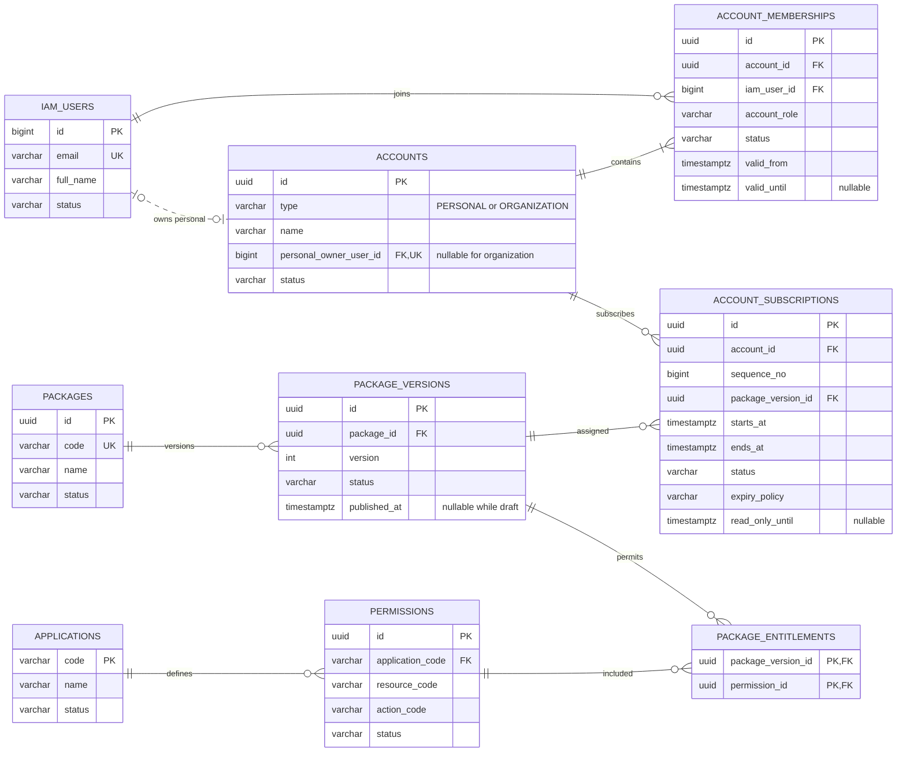
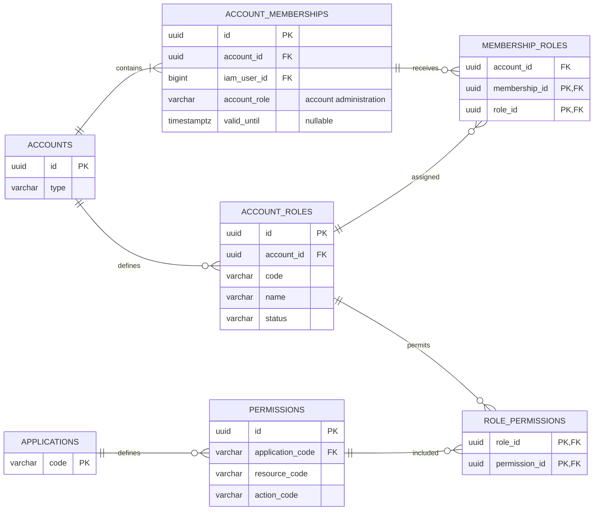
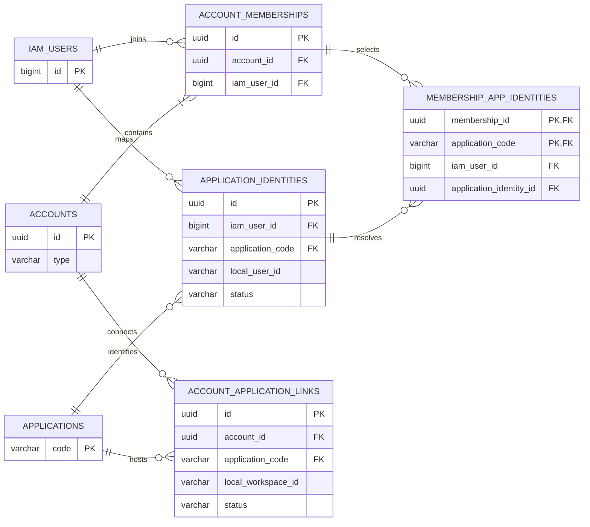

# Draft Schema Pusat dan ERD Akun TAGTOG

Tanggal 21 Oktober 2026. Status: rancangan untuk review. Dokumen dan diagram ini tidak menjalankan DDL, migration, seeding, perubahan kode aplikasi, atau deployment.

Rancangan memakai EMS-IAM sebagai sumber identitas, lalu menambahkan model workspace, anggota, paket akses, dan masa aktif. Akun PERSONAL melayani satu orang; akun ORGANIZATION melayani perusahaan. Satu identitas dapat mempunyai akun personal sekaligus menjadi anggota perusahaan. User ID lama setiap aplikasi tetap dipertahankan.

## Keputusan rancangan awal

1. `iam.users` tetap menjadi tabel identitas login dengan BIGINT yang sudah ada. Password tidak digandakan ke schema account.
2. Tabel bisnis pusat diusulkan berada pada schema PostgreSQL `access`. Semua ID bisnis baru memakai UUID; ini tidak mengganti primary key user, client, proyek, atau event lama.
3. Satu akun memiliki paling banyak satu paket utama yang berlaku pada satu waktu. Paket dapat mencakup EMS, PMS, dan CRM. Add-on serta masa aktif berbeda per aplikasi ditunda agar tidak ada penggabungan hak yang ambigu.
4. Isi paket yang sudah dipublikasikan dibuat tetap per versi. Subscription menunjuk versi yang tepat, sehingga mengedit katalog tidak diam-diam mengubah paket pelanggan lama.
5. Masa aktif paket, masa aktif anggota, dan masa sesi login merupakan tiga batas yang terpisah.
6. Role dan permission pelanggan berlaku dalam account yang dipilih. Role global platform seperti SUPER_ADMIN tetap terpisah.
7. Katalog `applications` adalah produk portal EMS/PMS/CRM. Kode fitur dan tindakannya harus direkonsiliasi dengan registry `ems.systems/features` serta pemeriksaan backend yang sudah ada sebelum migration disetujui. Katalog baru tidak langsung menggantikan registry EMS pada tahap rencana ini.

## ERD akun dan paket

`PK` adalah primary key, `FK` foreign key, `UK` unique key. Satu user dapat mempunyai banyak membership; account mempunyai riwayat subscription, tetapi periode paket utama yang berlaku tidak boleh bertumpuk.

## ERD role dan permission

`account_role` pada membership mengatur administrasi account, misalnya mengundang anggota. `account_roles` beserta permission-nya mengatur tindakan bisnis di aplikasi. Menjadi OWNER perusahaan tidak otomatis menjadikan user ADMIN global di PMS atau CRM.

## ERD penghubung aplikasi lama

Satu identitas IAM bisa mempunyai lebih dari satu user lokal pada aplikasi yang sama bila ada duplikasi atau pembagian akun lama. `membership_app_identities` memilih satu identitas lokal yang benar untuk account tersebut. Ini menghindari keharusan menggabungkan atau mengganti ID lama.

## Kamus tabel inti

Kolom audit umum untuk tabel utama baru: `created_at TIMESTAMPTZ NOT NULL`, `updated_at TIMESTAMPTZ NOT NULL`, serta `created_by_user_id BIGINT NULL FK iam.users` bila ada pelaku manusia. Tabel penghubung cukup mempunyai waktu pembuatan dan mencatat perubahan dalam audit IAM yang diperluas. Kolom berikut adalah rancangan, bukan schema yang sudah terpasang.

Semua kolom wajib NOT NULL kecuali yang ditandai NULL secara eksplisit. Ini termasuk seluruh bagian composite FK: `membership_roles.account_id` serta `membership_app_identities.iam_user_id/application_identity_id`. Jika ada bagian yang nullable, pemeriksaan composite FK PostgreSQL dapat dilewati sehingga jaminan account/orang yang sama tidak berlaku.

### Identitas dan workspace

| Tabel | Kolom utama | Batasan |
| --- | --- | --- |
| `iam.users` yang sudah ada | `id BIGINT PK`, `email`, `full_name`, `password_hash`, `status` | Tidak diduplikasi. Status global IAM mengatur apakah identitas boleh login. |
| `access.accounts` | `id UUID PK`, `type VARCHAR(16)`, `name VARCHAR(200)`, `personal_owner_user_id BIGINT NULL FK iam.users`, `status VARCHAR(16)` | Type PERSONAL/ORGANIZATION; status ACTIVE/SUSPENDED/CLOSED. PERSONAL wajib owner; ORGANIZATION memakai NULL pada kolom personal owner. Unik satu personal account per owner. |
| `access.account_memberships` | `id UUID PK`, `account_id UUID FK`, `iam_user_id BIGINT FK`, `account_role VARCHAR(16)`, `status VARCHAR(16)`, `valid_from TIMESTAMPTZ`, `valid_until TIMESTAMPTZ NULL` | UNIQUE `(account_id, iam_user_id)`. Account role OWNER/ADMIN/MEMBER; status ACTIVE/SUSPENDED/LEFT. `valid_until > valid_from` bila terisi. |

Account PERSONAL mempunyai tepat satu membership milik personal owner dengan account role OWNER. Account dan membership tersebut dibuat secara atomik. Pada rancangan awal, undangan anggota hanya tersedia di ORGANIZATION; personal account yang memerlukan tim perlu proses konversi yang disepakati.

Usulan enforcement: CHECK pada accounts memastikan jenis account cocok dengan NULL/non-NULL personal owner, UNIQUE menjaga satu personal account per orang, dan deferred constraint trigger saat commit memastikan PERSONAL hanya mempunyai satu membership, user-nya sama dengan personal owner, serta role-nya OWNER. Pemeriksaan ini berlaku juga pada perubahan type/owner/membership; transaksi sementara tidak boleh meninggalkan kondisi yang salah setelah commit. Ini masih spesifikasi constraint, bukan trigger yang dibuat.

ORGANIZATION mempunyai sekurangnya satu owner saat dibuat. Penghapusan atau penonaktifan owner terakhir perlu transfer atau pemulihan oleh administrator pusat. Batas waktu owner tetap berlaku; sistem tidak memperpanjang hak otomatis jika semua owner telah expired.

Admin perusahaan mengatur membership dalam perusahaannya. Admin perusahaan tidak boleh menonaktifkan identitas IAM global, karena orang yang sama mungkin masih mempunyai account personal atau keanggotaan perusahaan lain.

### Katalog aplikasi dan paket

| Tabel | Kolom utama | Batasan |
| --- | --- | --- |
| `access.applications` | `code VARCHAR(32) PK`, `name VARCHAR(120)`, `status VARCHAR(16)` | Kode awal EMS/PMS/CRM; status ENABLED/DISABLED. Ini katalog produk, bukan tabel company/client. |
| `access.permissions` | `id UUID PK`, `application_code VARCHAR(32) FK`, `resource_code VARCHAR(64)`, `action_code VARCHAR(32)`, `status VARCHAR(16)` | UNIQUE `(application_code, resource_code, action_code)`; status ENABLED/DISABLED. Contoh PMS/project/VIEW; tindakan awal VIEW/CREATE/UPDATE/DELETE. Tindakan tambahan harus terdaftar secara eksplisit. |
| `access.packages` | `id UUID PK`, `code VARCHAR(64) UK`, `name VARCHAR(160)`, `description TEXT NULL`, `status VARCHAR(16)` | Status ACTIVE/ARCHIVED. Nama komersial, harga, billing, dan kuota belum ditetapkan. |
| `access.package_versions` | `id UUID PK`, `package_id UUID FK`, `version INTEGER`, `status VARCHAR(16)`, `published_at TIMESTAMPTZ NULL` | UNIQUE `(package_id, version)`; version positif. Status DRAFT/PUBLISHED/RETIRED. Hanya DRAFT yang dapat diubah. |
| `access.package_entitlements` | `package_version_id UUID PK/FK`, `permission_id UUID PK/FK` | Primary key gabungan. Baris yang ada memberi hak tersebut; baris yang tidak ada berarti tidak diberikan. |

Isi dan nomor versi PUBLISHED beserta entitlement-nya tidak diubah atau dihapus. Lifecycle PUBLISHED menjadi RETIRED tetap diperbolehkan dan diaudit; `published_at` wajib terisi untuk keduanya. Perubahan isi paket menghasilkan versi berikutnya. RETIRED menghentikan penetapan baru, tetapi tidak mencabut hak subscription lama secara otomatis. Penonaktifan aplikasi/permission untuk alasan operasional merupakan tindakan pusat yang terpisah dan harus diaudit.

Makna permission juga tetap: tuple aplikasi/resource/action tidak diganti pada ID yang sudah digunakan. Perubahan makna menghasilkan permission ID baru; hanya atribut tampilan dan status operasional yang dapat berubah. Kode aplikasi tidak dialihkan ke produk lain. Dengan begitu versi paket lama tidak berubah melalui edit katalog di belakangnya. Publication memerlukan setidaknya satu permission terdaftar yang valid.

Paket dapat digunakan oleh akun PERSONAL dan ORGANIZATION. Versi awal belum membedakan harga atau kuota berdasarkan jenis account. Pembatasan jumlah anggota/proyek/event dapat dirancang kemudian dengan definisi pengukuran yang jelas; tidak dimasukkan sebagai angka bebas dalam entitlement saat ini.

### Subscription dan masa aktif

| Tabel | Kolom utama | Batasan |
| --- | --- | --- |
| `access.account_subscriptions` | `id UUID PK`, `account_id UUID FK`, `sequence_no BIGINT`, `package_version_id UUID FK`, `starts_at TIMESTAMPTZ`, `ends_at TIMESTAMPTZ`, `status VARCHAR(16)`, `expiry_policy VARCHAR(16)`, `read_only_until TIMESTAMPTZ NULL`, `cancelled_at TIMESTAMPTZ NULL` | Status ENABLED/SUSPENDED/CANCELLED. UNIQUE `(account_id, sequence_no)`; nomor positif dan meningkat dalam transaksi account. Wajib `ends_at > starts_at`; CANCELLED wajib `cancelled_at`, status lain memakai NULL. Penetapan baru hanya untuk package ACTIVE dan version PUBLISHED. |

Periode subscription utama berstatus ENABLED atau SUSPENDED tidak boleh bertumpuk untuk account yang sama. Masa suspension tetap menempati periode tersebut; membuat pengganti memerlukan pembatalan atau penyesuaian periode yang diaudit. Perpanjangan dibuat sebagai baris subscription baru, dengan tanggal mulai sama dengan akhir periode sebelumnya bila tidak ada jeda.

Status SCHEDULED, ACTIVE, dan EXPIRED pada tampilan dihitung dari tanggal, bukan disimpan sebagai status lain yang dapat menjadi tidak sinkron. Pembatalan berlaku segera pada `cancelled_at`; draft ini belum memuat pembatalan terjadwal atau perhitungan pembayaran. CANCELLED bersifat terminal; pemberian hak kembali memakai record pengganti dengan `sequence_no` baru. Nomor urut ditetapkan server, tidak diubah setelah dibuat, dan bukan input UI. Nomor urut dan record cancellation tidak dihapus untuk membuka kembali hak lama.

`expiry_policy` bernilai BLOCK atau READ_ONLY. Default usulan adalah BLOCK. READ_ONLY wajib mempunyai `read_only_until > ends_at` yang terhingga; ini memberi ruang mempertahankan pola kontrak EMS jika disepakati. READ_ONLY hanya mengizinkan VIEW atas hak/data yang sebelumnya tercakup, dengan membership dan role yang masih berlaku. Hak ekspor atau unduh yang sensitif memerlukan permission tersendiri bila nanti ditambahkan.

BLOCK memakai `read_only_until = NULL`. READ_ONLY tidak membuat snapshot database; resource yang dapat dibaca tetap mengikuti scope aplikasi dan permission versi paket terakhir.

Jika subscription baru sudah berlaku, paket baru menjadi satu-satunya sumber entitlement; hak masa read-only paket lama tidak ditambahkan. Suspension atau cancellation tidak boleh memicu fallback ke paket lama. Riwayat paket tidak pernah dijumlahkan menjadi hak saat ini.

### Role dalam account

| Tabel | Kolom utama | Batasan |
| --- | --- | --- |
| `access.account_roles` | `id UUID PK`, `account_id UUID FK`, `code VARCHAR(64)`, `name VARCHAR(120)`, `status VARCHAR(16)` | UNIQUE `(account_id, code)`; status ACTIVE/INACTIVE. Role tidak berlaku di account lain. |
| `access.role_permissions` | `role_id UUID PK/FK`, `permission_id UUID PK/FK` | Primary key gabungan. Role memberi tindakan, tetapi tetap dibatasi oleh paket account. |
| `access.membership_roles` | `membership_id UUID PK`, `role_id UUID PK`, `account_id UUID` | Composite FK `(account_id, membership_id)` ke membership dan `(account_id, role_id)` ke role; keduanya harus berada pada account yang sama. |

Untuk composite FK tersebut, parent menyimpan UNIQUE `(account_id, id)` selain primary key `id`. Status role INACTIVE membatalkan pemberian hak role itu. Gabungan beberapa role diperbolehkan hanya di dalam membership/account yang sama, lalu dipotong oleh entitlement paket dan aturan resource aplikasi.

### Mapping ke aplikasi lama

| Tabel | Kolom utama | Batasan |
| --- | --- | --- |
| `access.application_identities` | `id UUID PK`, `iam_user_id BIGINT FK`, `application_code VARCHAR(32) FK`, `local_user_id VARCHAR(128)`, `status VARCHAR(16)` | Status ACTIVE/INACTIVE. UNIQUE `(application_code, local_user_id)`: satu user lokal hanya boleh diklaim satu identitas IAM. Tidak memaksakan UNIQUE user IAM per aplikasi, agar kasus akun lama ganda dapat ditinjau. |
| `access.membership_app_identities` | `membership_id UUID PK`, `application_code VARCHAR(32) PK`, `iam_user_id BIGINT`, `application_identity_id UUID` | Memilih tepat paling banyak satu user lokal per membership dan aplikasi. Composite FK memastikan user IAM sama dengan membership serta identitas lokal; application code juga harus sama. |
| `access.account_application_links` | `id UUID PK`, `account_id UUID FK`, `application_code VARCHAR(32) FK`, `local_workspace_id VARCHAR(128)`, `status VARCHAR(16)` | UNIQUE `(account_id, application_code)` dan UNIQUE `(application_code, local_workspace_id)` untuk kontrak satu workspace lokal per account. Status ACTIVE/INACTIVE. |

Composite FK pada pemilihan identitas memakai UNIQUE parent `(id, iam_user_id)` di membership serta `(id, iam_user_id, application_code)` di application identities. ID lokal disimpan sebagai string agar tetap dapat mewakili BIGINT atau UUID tanpa mengubah primary key aplikasi lama.

Adapter wajib memakai bentuk ID yang kanonik sebelum validasi, lookup, dan penyimpanan: BIGINT positif sebagai desimal tanpa nol depan/tanda plus; UUID memakai bentuk standar huruf kecil. `7` dan `007` tidak boleh membuat dua mapping untuk user yang sama. Kode aplikasi memakai bentuk uppercase terdaftar; resource code memakai bentuk lowercase terdaftar dan action memakai uppercase terdaftar.

Identitas lokal yang sama dapat dipilih pada beberapa membership milik orang yang sama jika aplikasi sudah mampu memisahkan workspace. Jika aplikasi belum mendukungnya, hanya mapping yang lolos pemeriksaan scope yang diaktifkan. Email hanya membantu pencarian kandidat; persamaan email tidak membuat link otomatis.

PMS `clients.id` dan CRM `companies.id` tidak otomatis diisi sebagai `local_workspace_id`. Keduanya baru boleh dipakai setelah cakupan data dan aturan aksesnya terbukti menjadi batas workspace yang benar. Ketika belum ada pemisahan tersebut, integrasi account perusahaan/personal pada aplikasi itu belum dapat dinyatakan siap.

## Aturan waktu dan pemilihan paket

Semua waktu bisnis memakai TIMESTAMPTZ/UTC. Tampilan dapat menggunakan WIB. Periode berlaku adalah `[mulai, akhir)`: tepat pada waktu akhir, hak periode itu sudah berakhir. Membership dengan `valid_until = NULL` tidak mempunyai batas akhir; subscription versi awal selalu mempunyai tanggal akhir.

Kontrak EMS lama yang tidak mempunyai tanggal akhir perlu keputusan migrasi tersendiri. Rancangan ini tidak mengarang tanggal akhir untuk kontrak tersebut; dukungan subscription tanpa batas akhir perlu disepakati dahulu bila diperlukan.

Urutan evaluasi usulan:

1. Tolak akses bisnis jika identitas IAM tidak aktif, account tidak ACTIVE, atau membership tidak ACTIVE/di luar masa aktifnya.
2. Ambil record dengan `starts_at <= sekarang`. Record CANCELLED sebelum tanggal mulai (`cancelled_at < starts_at`) dikeluarkan: rencana masa depan yang dibatalkan belum pernah memberikan hak dan tidak membatalkan periode lain. Cancellation pada/setelah mulai tetap ikut seleksi agar tidak membuka hak lama.
3. Pilih satu record paling akhir menurut `(starts_at DESC, sequence_no DESC)` dari kandidat tersebut, tanpa menyaring status lebih dahulu. UNIQUE sequence memastikan urutan total meskipun tanggal mulai sama. Bila kosong, tolak akses bisnis.
4. Record terpilih berstatus SUSPENDED/CANCELLED langsung memblokir. ENABLED dengan `sekarang < ends_at` memberi entitlement versi itu. ENABLED yang sudah berakhir hanya memberi VIEW jika READ_ONLY dan `sekarang < read_only_until`; selain itu ditolak. Tidak mencari paket lebih lama sebagai fallback.
5. Record pengganti yang sah, dengan tanggal mulai lebih baru atau tanggal sama dan nomor urut lebih tinggi, menjadi pilihan tunggal. Paket baru mengalahkan read-only paket lama. Periode belum mulai tidak memberi hak lebih awal. Tidak ada penggabungan riwayat paket.
6. Potong hak paket dengan role membership dan scope data backend aplikasi. Status aplikasi/permission serta mapping yang diperlukan harus masih aktif.

Ketika masa aktif anggota berakhir, akses bisnis anggota itu berhenti meskipun paket perusahaan masih aktif atau read-only. Ketika paket perusahaan berakhir, IAM user serta paket personalnya tetap ada. Tidak ada pemindahan data perusahaan ke akun personal.

Portal dapat menyediakan halaman status account/paket dan proses renewal yang terpisah dari akses bisnis. Membership owner yang sudah berakhir tidak memperoleh hak bisnis tambahan; pemulihan atau transfer ownership melalui proses pusat yang eksplisit.

## Kontrak akses lintas aplikasi

Account terpilih dan membership diikat pada konteks sesi yang divalidasi server, bersama identitas IAM dan audience aplikasi. Pergantian workspace menghasilkan konteks baru. Backend tidak menerima `account_id` dari UI sebagai bukti akses dan tidak menggabungkan role personal/perusahaan.

Secara konseptual, tindakan hanya diizinkan bila seluruh kondisi berikut terpenuhi:

`identitas aktif AND account aktif AND membership berlaku AND paket memberi hak AND role memberi hak AND mapping sah AND resource berada dalam scope account/aplikasi`

Pencabutan membership/role/mapping dan perubahan status harus berlaku pada pemeriksaan akses berikutnya. Tanggal akhir dievaluasi saat request; job malam atau expiry token bukan satu-satunya mekanisme pencabutan.

Role global IAM dan role bisnis account mempunyai kewenangan berbeda. Akses dukungan oleh administrator platform harus eksplisit dan diaudit; tidak muncul karena membership pelanggan tidak ditemukan.

## Contoh keputusan akses

Contoh berikut hanya ilustrasi aturan, bukan paket/harga atau data user yang dibuat.

| Kondisi | Keputusan |
| --- | --- |
| User punya paket personal PMS dan menjadi anggota perusahaan dengan paket EMS/CRM | Workspace personal hanya memakai paket personal. Workspace perusahaan memakai paket perusahaan dan role anggota itu. |
| Paket perusahaan masih aktif, membership anggota sudah berakhir | Anggota tersebut ditolak di perusahaan; anggota lain yang masih berlaku tetap dapat mengakses. |
| Paket perusahaan berakhir dengan BLOCK | Akses bisnis perusahaan berhenti; identitas dan akses personal yang masih berlaku tidak ikut dimatikan. |
| Paket perusahaan READ_ONLY sampai 7 hari kemudian | Anggota yang masih berlaku dan mempunyai VIEW dapat membaca data yang tercakup; CREATE/UPDATE/DELETE ditolak. Durasi 7 hari di sini hanya contoh. |
| Paket versi 2 sudah dipublikasikan, pelanggan masih memakai versi 1 | Hak pelanggan tetap versi 1 sampai ada subscription/perubahan terjadwal yang sah. |
| Paket lama memberi CRM, paket baru hanya PMS | Ketika paket baru berlaku, CRM tidak ikut terbawa dari riwayat paket lama. |
| Record lama ENABLED Jan–Mar, record lebih baru mulai Feb lalu CANCELLED setelah mulai | Di Februari record cancellation memblokir; sistem tidak memilih paket Jan–Mar sebagai fallback. |
| Perpanjangan bulan depan dibatalkan sebelum tanggal mulainya | Perpanjangan itu tidak memberi hak dan tidak mencabut masa aktif/read-only periode lain yang masih sah. |
| Role PMS pada account A dihubungkan ke member account B | Ditolak oleh constraint account yang sama dan pemeriksaan server. |

## Penyesuaian aplikasi yang perlu direncanakan

- **EMS:** rekonsiliasi `client_accounts`, template paket, snapshot `event_features`, dan contract dates. Dukungan beberapa account per user memerlukan perubahan query scope serta constraint membership lama. Hilangnya membership pelanggan harus ditolak, bukan berubah menjadi scope Internal. Pola read-only EMS perlu disepakati dengan kebijakan expiry pusat.
- **PMS:** pertahankan user ID, project membership, client folder shares, dan role viewer. Relasi client serta role ADMIN/MANAGER lama tidak otomatis menjadi batas perusahaan. Perlu pemetaan resource ke workspace sebelum company/personal isolation dinyatakan benar. Employment type atau client user tidak boleh ditimpa setiap pergantian account.
- **CRM:** rencanakan status identitas, sesi yang aman, account scope pada data, serta pemeliharaan `user_allowed_events`. Company pelanggan tidak otomatis menjadi tenant. Token sesi berbasis ID angka pada source perlu diperbaiki sebelum integrasi.
- **IAM dan registry:** sepakati kepemilikan katalog produk/permission, normalisasi profil, audit account, dan mapping role lama. Password/ID lama tidak digabung berdasarkan email.

## Urutan review dan kriteria penerimaan

Pertama review entitas, cardinality, dan kebijakan expiry bersama pemilik EMS/PMS/CRM. Berikutnya cocokkan source/migration dengan metadata database yang benar-benar dipakai serta inventarisasi konflik identitas dan kepemilikan data. Baru kemudian disusun migration additive, adapter aplikasi, pengujian lokal, dan rencana rollback.

Rancangan siap diterjemahkan menjadi implementasi bila reviewer menyepakati:

- Personal dan organisasi memiliki scope yang terpisah, termasuk ketika user yang sama berpindah account.
- Subscription utama tidak bertumpuk; versi paket yang sudah dipakai tetap dapat direproduksi.
- Periode anggota/paket, suspension, cancellation, dan read-only mempunyai hasil yang pasti tepat pada batas waktu.
- Tidak ada perluasan hak akibat membership hilang, role account lain, email sama, atau riwayat paket.
- Mapping mempertahankan seluruh user ID dan kepemilikan bisnis yang ada.
- Migration memperhitungkan model EMS yang sudah mempunyai account/contract dan model PMS/CRM yang belum menjadi tenant penuh.

Audit sumber sebelumnya tersedia pada `RENCANA-INTEGRASI-AKUN.md`. Tidak ada tabel, user, paket, subscription, atau perubahan database yang dibuat oleh rancangan ini.
